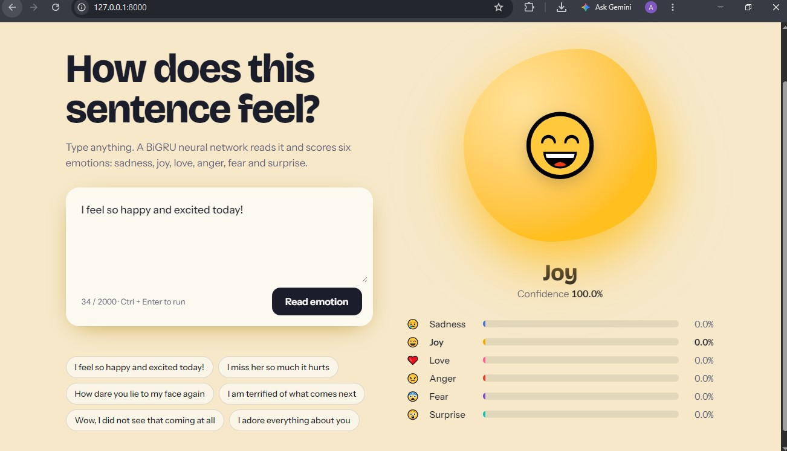
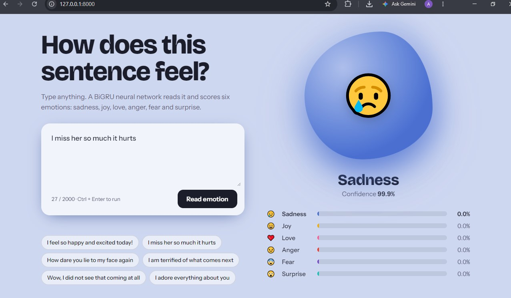
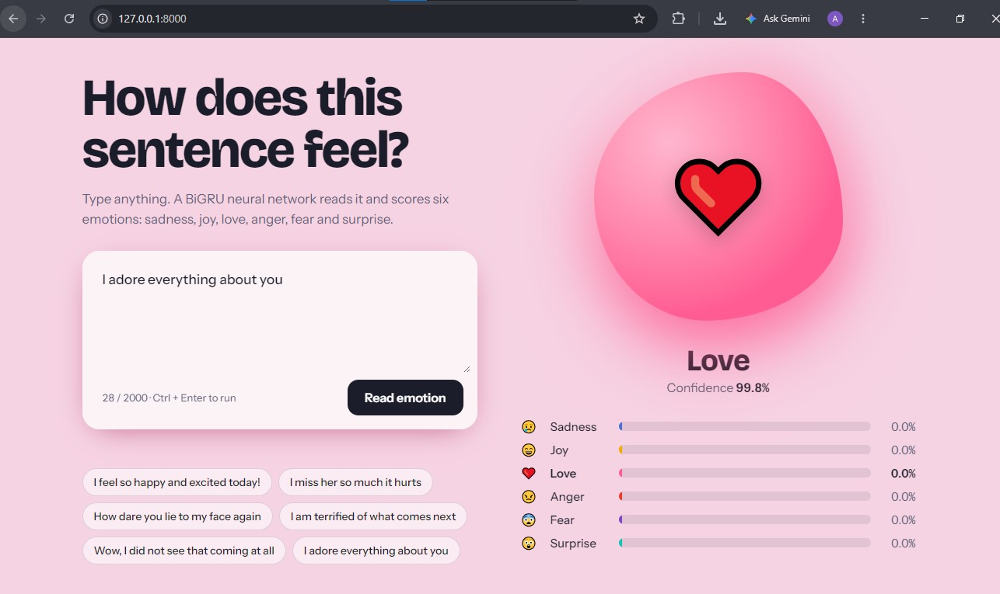
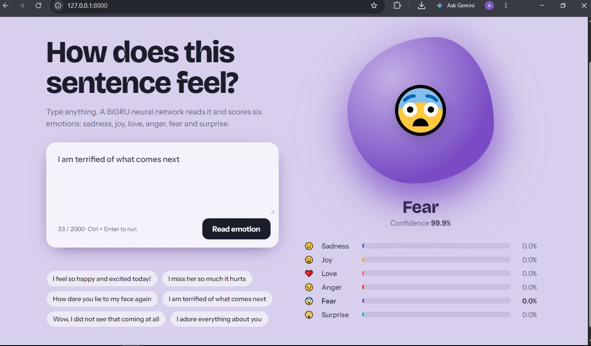
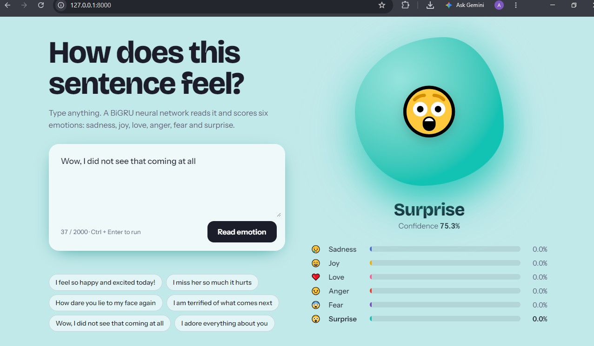
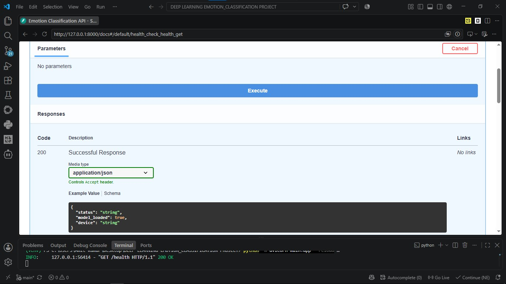
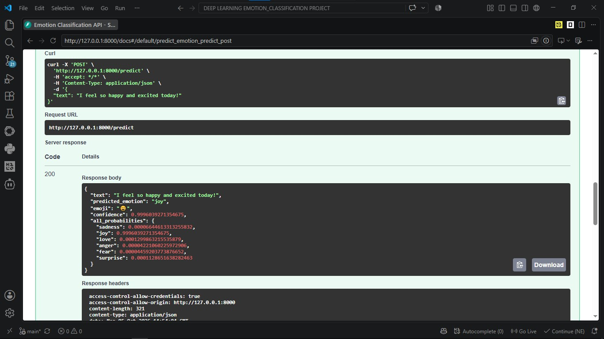

# 🧠 Model Card – Emotion Classification System

---

# Model Overview

This project is a Deep Learning based Emotion Classification System that predicts human emotions from textual input.

The model is built using RoBERTa and deployed using FastAPI with an interactive web interface.

The system classifies text into six emotional categories:

- 😊 Joy
- 😢 Sadness
- ❤️ Love
- 😡 Anger
- 😨 Fear
- 😲 Surprise

---

# Model Information

| Property | Value |
|-----------|---------|
| Model Name | Emotion Classification Model |
| Architecture | RoBERTa |
| Framework | Hugging Face Transformers |
| Task | Multi-Class Text Classification |
| Classes | 6 |
| Language | English |
| Backend | FastAPI |
| Frontend | HTML, CSS, JavaScript |
| Deployment | Render |
| Author | Amit Kumar |
| Version | 1.0 |

---

# Problem Statement

Understanding emotions from text is an important Natural Language Processing (NLP) task.

The objective of this project is to automatically identify emotional states from user-provided text.

Example:

Input:

```text
I feel so happy and excited today!
```

Output:

```text
Joy
```

The model can be integrated into:

- Mental health applications
- Customer feedback analysis
- Chatbots
- Sentiment monitoring systems
- Social media analytics
- Human-computer interaction systems

---

# Supported Emotion Classes

| Emotion | Description |
|----------|-------------|
| Joy | Happiness, excitement, pleasure |
| Sadness | Grief, disappointment, loneliness |
| Love | Affection, care, attachment |
| Anger | Frustration, irritation, rage |
| Fear | Anxiety, nervousness, worry |
| Surprise | Shock, amazement, unexpected reaction |

---

# Dataset Information

## Dataset Type

Emotion Classification Dataset

## Number of Classes

6

## Classes

```text
joy
sadness
love
anger
fear
surprise
```

## Dataset Distribution

The dataset contains labeled text samples representing emotional expressions.

Example:

```text
Text:
"I miss her so much."

Label:
sadness
```

```text
Text:
"I adore everything about you."

Label:
love
```

```text
Text:
"I am terrified of what comes next."

Label:
fear
```

---

# Model Architecture

## Base Model

RoBERTa

## Components

```text
Input Text
      │
      ▼
Tokenizer
      │
      ▼
RoBERTa Encoder
      │
      ▼
Classification Head
      │
      ▼
Softmax Layer
      │
      ▼
Emotion Prediction
```

---

# Tokenization

Tokenizer Used:

```text
RoBERTa Tokenizer
```

Stored Files:

```text
tokenizer.json
tokenizer_config.json
```

---

# Training Configuration

| Parameter | Value |
|------------|---------|
| Optimizer | AdamW |
| Loss Function | CrossEntropyLoss |
| Learning Rate | 2e-5 |
| Framework | PyTorch |
| Training Library | Hugging Face Trainer |

---

# Model Files

Stored inside:

```text
best_emotion_model/
```

Files:

```text
config.json
model.safetensors
tokenizer.json
tokenizer_config.json
training_args.bin
```

Purpose:

| File | Description |
|---------|------------|
| config.json | Model configuration |
| model.safetensors | Trained model weights |
| tokenizer.json | Tokenizer vocabulary |
| tokenizer_config.json | Tokenizer settings |
| training_args.bin | Training configuration |

---

# API Architecture

The model is served through FastAPI.

Endpoint:

```http
POST /predict
```

Request:

```json
{
    "text": "I feel so happy and excited today!"
}
```

Response:

```json
{
    "predicted_emotion": "joy",
    "confidence": 0.998,
    "all_probabilities": {
        "joy": 0.998,
        "sadness": 0.001,
        "love": 0.001,
        "anger": 0.000,
        "fear": 0.000,
        "surprise": 0.000
    }
}
```

---

# Example Predictions

## Example 1

Input:

```text
I feel so happy and excited today!
```

Prediction:

```text
Joy
```

---

## Example 2

Input:

```text
I miss her so much it hurts.
```

Prediction:

```text
Sadness
```

---

## Example 3

Input:

```text
I adore everything about you.
```

Prediction:

```text
Love
```

---

## Example 4

Input:

```text
I am terrified of what comes next.
```

Prediction:

```text
Fear
```

---

## Example 5

Input:

```text
Wow, I did not see that coming.
```

Prediction:

```text
Surprise
```

---

# Model Performance

⚠️ Replace these values with actual evaluation metrics from your training run.

| Metric | Value |
|-----------|---------|
| Accuracy | XX.XX% |
| Precision | XX.XX% |
| Recall | XX.XX% |
| F1 Score | XX.XX% |

---

# Screenshots

## Application Interface



---

## Sadness Prediction



---

## Love Prediction



---

## Fear Prediction



---

## Surprise Prediction



---

## API Documentation



---

## API Response



---

# Deployment Information

Deployment Platform:

```text
Render
```

Backend:

```text
FastAPI
```

Application Server:

```text
Uvicorn
```

Documentation:

```text
/docs
```

---

# Limitations

Current limitations of the model:

- Supports English language only
- Performance may decrease on very short text
- Sarcasm detection is limited
- Mixed-language sentences may reduce accuracy
- Context-dependent emotions may not always be captured

---

# Ethical Considerations

This model is intended for educational and research purposes.

The predictions should not be used as:

- Medical diagnosis
- Psychological assessment
- Legal decision-making
- Employment screening

Human review is recommended before taking critical decisions.

---

# Future Improvements

Planned improvements:

- Hindi Emotion Detection
- Multilingual Support
- Explainable AI (XAI)
- Emotion Analytics Dashboard
- Speech Emotion Recognition
- Real-Time Monitoring System
- User History Tracking

---

# Author

**Amit Kumar**

B.Sc Computer Science & Data Analytics

AI / ML Engineer

GitHub:
https://github.com/your-username

LinkedIn:
https://linkedin.com/in/your-profile

---

# License

This project is released under the MIT License.